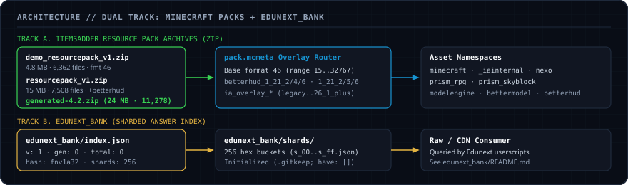
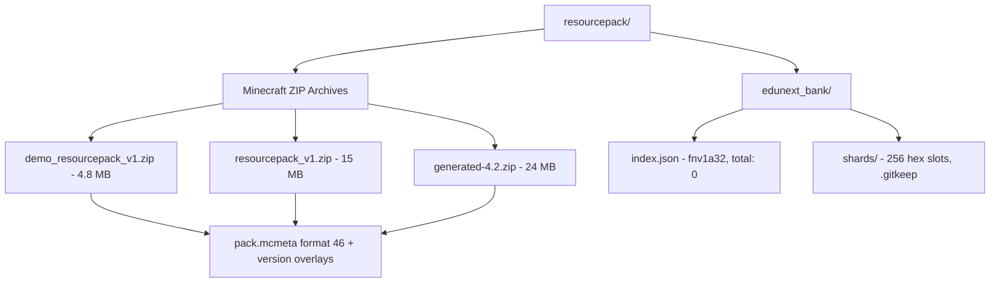

<p align="center">
  
</p>

<p align="center">
  
  
  
</p>

Asset repository holding three ItemsAdder-generated Minecraft Java Edition resource pack archives alongside an initialized 256-shard FNV-1a answer bank directory (`edunext_bank/`).

---

## Table of Contents

- [Overview](#overview)
- [Architecture](#architecture)
- [File Structure and Archive Inventory](#file-structure-and-archive-inventory)
- [Prerequisites](#prerequisites)
- [Usage](#usage)
- [Scope and Limits](#scope-and-limits)
- [License](#license)

---

## Overview

This repository houses two separate static asset sets used during development and testing. The root level holds three Minecraft resource pack ZIP builds (`demo_resourcepack_v1.zip`, `resourcepack_v1.zip`, and `generated-4.2.zip`) built with ItemsAdder multi-version overlays and Sodium shader exclusions. Underneath `edunext_bank/` sits the empty scaffold for a 256-bucket FNV-1a shared answer index (`index.json` currently reports `total: 0` and `have: []`).

---

## Architecture

<p align="center">
  
</p>



---

## File Structure and Archive Inventory

| Path | Size | Contents and Verified Details |
| --- | --- | --- |
| `demo_resourcepack_v1.zip` | `4.8 MB` | `6,362` entries; base `pack_format: 46`; namespaces `bettermodel`, `_iainternal`, `infinitecrops`, `minecraft`, `modelengine`, `nexo`, `prism_rpg`, `prism_skyblock`; overlays `1_21_6` and `ia_overlay_*` |
| `resourcepack_v1.zip` | `15 MB` | `7,508` entries; same overlay layout as `demo_resourcepack_v1.zip` plus the `assets/betterhud` namespace |
| `generated-4.2.zip` | `24 MB` | `11,278` entries; `supported_formats: [15, 64]`, `pack_format: 46`; adds `betterhud_1_21_2`, `betterhud_1_21_4`, `betterhud_1_21_6`, `1_21_2`, `1_21_5`, `ia_overlay_1_21_6_to_11`, and `ia_overlay_26_1_plus` |
| `edunext_bank/index.json` | `153 B` | Catalog metadata (`"kind": "shared-answer-bank"`, `"hash": "fnv1a32"`, `"shards": 256`, `"total": 0`, `"have": []`) |
| `edunext_bank/README.md` | `1.8 KB` | Vietnamese schema and contribution workflow documentation for the shared bank |
| `edunext_bank/shards/.gitkeep` | `0 B` | Placeholder keeping `shards/` tracked before any shard JSON files are collected |

All three resource pack archives include `sodium.ignored_shaders` entries in `pack.mcmeta` for `rendertype_entity_translucent.fsh` and `rendertype_entity_translucent.vsh`.

---

## Prerequisites

- **Minecraft Java Edition** (pack format `15` onward; primary base `pack_format: 46` for 1.21.4+, with overlays up to format `84` in `generated-4.2.zip`).
- `unzip` or any standard archive inspector to examine pack manifests locally.

---

## Usage

### Inspecting or installing a resource pack

```bash
git clone https://github.com/broamstuck-cybr/resourcepack.git
cd resourcepack

# Verify archive integrity and read pack.mcmeta without extracting everything
unzip -t generated-4.2.zip
unzip -p generated-4.2.zip pack.mcmeta
```

To test a pack in Minecraft, copy the chosen `.zip` archive directly into your client's `resourcepacks/` folder and enable it under **Options -> Resource Packs**.

### Reading the `edunext_bank` schema

Check the current catalog state and schema instructions in [edunext_bank/index.json](edunext_bank/index.json) and [edunext_bank/README.md](edunext_bank/README.md). No shard data files are populated in `edunext_bank/shards/` yet.

---

## Scope and Limits

- Only compiled/exported `.zip` archives are stored here; raw ItemsAdder YAML configs and source Blender/Blockbench project files are not included.
- `edunext_bank/` is currently an empty initialized scaffold (`gen: 0`, `total: 0`, `have: []`).
- Third-party plugin assets inside the ZIP archives (`ItemsAdder`, `ModelEngine`, `BetterHUD`, `Nexo`, `BetterModel`, `InfiniteCrops`) remain subject to their respective authors' terms.

---

## License

No repository-wide `LICENSE` file is present. Compiled pack archives and `edunext_bank/` scaffold files are stored for reference and personal server configuration testing only.
